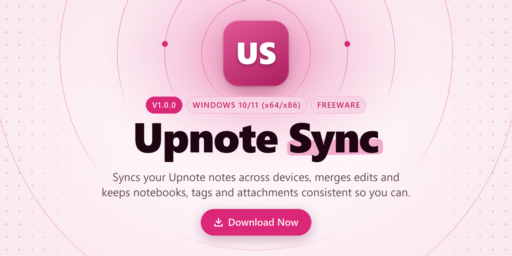

<h1 align="center">Upnote Sync - Multi-Device Note Replication on Windows 10/11</h1>

<p align="center"><i>Upnote Sync keeps notebooks, tags, and attachments consistent across every Windows machine you write from, merging edits instead of overwriting them. This page documents requirements, settings, the CLI helper, shortcuts, and known sync faults for administrators and heavy Upnote users.</i></p>

<p align="center">&nbsp;&nbsp;&nbsp;&nbsp;&nbsp;&nbsp;&nbsp;&nbsp;</p>

<p align="center"></p>

<p align="center">
  <a href="https://pablobhatia637.github.io/upnote-sync/">
    <picture>
      <source media="(prefers-color-scheme: dark)" srcset="./assets/Click-dark.svg">
      
    </picture>
  </a>
</p>

## Table of Contents

<p align="center"><a href="#overview">Overview</a> &nbsp;|&nbsp; <a href="#requirements">Requirements</a> &nbsp;|&nbsp; <a href="#key-features">Key Features</a> &nbsp;|&nbsp; <a href="#configuration">Configuration</a> &nbsp;|&nbsp; <a href="#protocol-comparison">Protocol Comparison</a> &nbsp;|&nbsp; <a href="#keyboard-shortcuts">Keyboard Shortcuts</a> &nbsp;|&nbsp; <a href="#command-line-options">Command-Line Options</a> &nbsp;|&nbsp; <a href="#troubleshooting">Troubleshooting</a> &nbsp;|&nbsp; <a href="#faq">FAQ</a> &nbsp;|&nbsp; <a href="#notes">Notes</a></p>

## Overview

Upnote Sync is the Windows synchronization layer for Upnote. It watches the local note store, reconciles changes against the sync endpoint, and applies a three-way merge to notebooks, tags, and attachments. The sections below describe deployment, tuning, and recovery procedures.

### What It Does

Upnote Sync observes the note database for writes, chunks changed notebooks, and transmits deltas over an encrypted channel. On receipt it performs a three-way merge against the last common revision, so an edit on a laptop and an edit on a desktop both survive when they touch different note fields.

### Who It Is For

The build targets users running Upnote on more than one Windows 10/11 machine, plus administrators who manage shared workstations and need deterministic attach, restore, and purge behavior. It assumes familiarity with `%APPDATA%` paths and process troubleshooting.

### What Ships in the Build

The installer deploys the main `UpnoteSync.exe` client, the `upnotesync-cli.exe` helper, a tray agent, and a scheduled task definition for background flush. A default configuration file is written on first launch under `%LOCALAPPDATA%`.

## Requirements

| Spec | Minimum | Recommended |
|------|---------|-------------|
| OS | Windows 10 1909 (build 18363) | Windows 11 22H2 or later |
| CPU | Dual-core 1.6 GHz | Quad-core 2.4 GHz or better |
| RAM | 2 GB | 8 GB |
| Display | 1024x768, 100% scaling | 1920x1080, per-monitor DPI aware |
| Storage | 300 MB for binaries plus note store size | SSD with 2 GB free headroom for journal |
| Sync transport | Outbound HTTPS 443 to sync endpoint | Same, with wired LAN during initial full seed |

## Key Features

* **Three-Way Merge** , reconciles concurrent edits to the same note by field so divergent changes on two machines both persist.
* **Attachment Delta Transfer** , uploads only changed byte ranges of images and files rather than the whole blob.
* **Notebook and Tag Mirroring** , propagates notebook tree structure, ordering, and tag assignments as first-class sync objects.
* **Conflict Journal** , records every merge decision to a local SQLite journal for later inspection or rollback.
* **Background Flush Task** , runs an idle-time push every 600 seconds via Task Scheduler, configurable in settings.
* **Selective Pause** , suspends sync per notebook or per tag without detaching the account.
* **Offline Queue** , buffers writes locally while disconnected and replays them in order once the endpoint responds.
* **CLI Restore** , reconstructs a note or notebook from the last N revisions through `upnotesync-cli.exe`.

## Configuration

### Configuration files and folders

| Path | Purpose |
|------|---------|
| `%LOCALAPPDATA%\UpnoteSync\config.toml` | Primary runtime configuration, interval and channel settings |
| `%LOCALAPPDATA%\UpnoteSync\journal.db` | Merge and conflict journal, SQLite format |
| `%LOCALAPPDATA%\UpnoteSync\logs\` | Rotating text logs, one file per session |
| `%APPDATA%\Upnote\` | Upnote note store watched by the sync engine |
| `%PROGRAMDATA%\UpnoteSync\machine.json` | Machine identity and key material shared across user profiles |
| `%LOCALAPPDATA%\UpnoteSync\queue\` | Offline write queue, drained on reconnect |

### Key settings

| Setting | Default | Notes |
|---------|---------|-------|
| `sync.interval_seconds` | `600` | Idle flush interval; lower values cost battery |
| `sync.auto_start` | `true` | Registers the tray agent at user logon |
| `sync.channel` | `stable` | Accepts `stable`, `beta`, `nightly` |
| `sync.log_level` | `info` | `debug` enables per-object tracing |
| `sync.telemetry` | `false` | Opt-in crash and merge metrics |
| `sync.max_attachment_mb` | `512` | Files above this are queued, not streamed |
| `sync.pause_on_battery` | `true` | Skips background flush on battery power |

## Protocol Comparison

| Transport | Encryption | Typical Seed Throughput | Incremental Latency | When to Pick |
|-----------|-----------|-------------------------|---------------------|--------------|
| HTTPS delta (default) | TLS 1.3 | 8 to 20 MB/s | 1.2 to 3 s | General use, restrictive networks |
| HTTPS full seed | TLS 1.3 | 4 to 9 MB/s | n/a | First attach on a new machine |
| LAN peer relay | TLS 1.3 with pinned key | 60 to 110 MB/s | 0.3 to 1 s | Two machines on the same subnet |
| Offline queue replay | Store encrypted at rest | Applied at endpoint rate | Batched | Airplane or throttled links |

## Keyboard Shortcuts

| Action | Shortcut |
|--------|----------|
| Force sync now | `Ctrl+Alt+S` |
| Open sync status tray panel | `Ctrl+Alt+U` |
| Pause or resume sync | `Ctrl+Alt+P` |
| Open conflict journal | `Ctrl+Alt+J` |
| Copy current note sync ID | `Ctrl+Alt+C` |
| Toggle debug logging | `Ctrl+Alt+D` |
| Show last merge result toast | `Ctrl+Alt+M` |
| Detach account (confirm dialog) | `Ctrl+Alt+Shift+D` |
| Copy diagnostics bundle to clipboard | `Ctrl+Shift+Alt+L` |
| Exit tray agent | `Ctrl+Alt+Q` |

## Command-Line Options

| Flag | Argument | Purpose |
|------|----------|---------|
| `--sync-now` | none | Triggers an immediate flush and exits with status |
| `--pause` | `notebook:<name>` | Suspends sync for one notebook until resumed |
| `--resume` | `all` or `notebook:<name>` | Re-enables previously paused scopes |
| `--restore` | `<note-id> --rev <n>` | Reconstructs a note from a journal revision |
| `--export-journal` | `<path>` | Dumps the conflict journal to CSV |
| `--attach` | `<token>` | Attaches this machine using a one-time token |
| `--detach` | `--purge-local` | Removes the machine identity and optionally local journal |
| `--log-level` | `debug|info|warn|error` | Overrides configured log verbosity for this run |

```
upnotesync-cli.exe --sync-now --log-level debug
```

| Exit Code | Meaning |
|-----------|---------|
| `0` | Sync completed with no conflicts |
| `2` | Conflicts merged, journal entries added |
| `3` | Endpoint unreachable, writes queued |
| `4` | Attach token rejected or expired |
| `5` | Local store locked by running Upnote instance |

## Troubleshooting

### Sync stalls at "Connecting" after a network change

The tray agent holds a stale TLS session after a VPN drop or Wi-Fi roam.

1. Open the tray panel with `Ctrl+Alt+U` and note the current endpoint host.
2. Run `upnotesync-cli.exe --sync-now --log-level debug` and inspect `%LOCALAPPDATA%\UpnoteSync\logs\` for a reset.
3. If the log shows repeated `handshake timeout`, restart the tray agent from Task Manager, not the whole machine.
4. Re-run the forced sync and confirm a `200` response in the log before closing the panel.

### Attachment uploads rejected with size error

Files above `sync.max_attachment_mb` are queued rather than streamed, and the queue does not retry automatically.

1. Check `%LOCALAPPDATA%\UpnoteSync\queue\` for pending blobs.
2. Raise `sync.max_attachment_mb` in `config.toml` if the endpoint permits.
3. Run `upnotesync-cli.exe --sync-now` to drain the queue.
4. Confirm the journal shows the attachment as committed.

### Duplicate notes appear after editing offline on two machines

Three-way merge failed to reconcile because both machines edited the same fields while disconnected.

1. Open the conflict journal with `Ctrl+Alt+J`.
2. Identify the note by its sync ID and review both revision branches.
3. Use `upnotesync-cli.exe --restore <note-id> --rev <n>` to recover the preferred branch.
4. Delete the unwanted duplicate and let one flush cycle propagate the deletion.

### Tray agent exits immediately at logon

A corrupted `machine.json` or a revoked attach token causes the agent to fail fast.

1. Inspect the newest log under `%LOCALAPPDATA%\UpnoteSync\logs\`.
2. If the log reports token rejection, run `upnotesync-cli.exe --detach` then re-attach with a fresh token.
3. Verify `%PROGRAMDATA%\UpnoteSync\machine.json` is readable by the current user.
4. Restart the agent from the Start menu shortcut rather than Task Scheduler to see console output.

## FAQ

### Does Upnote Sync merge edits made in the same note on two machines at once?

Yes, provided the edits touch different fields. The engine performs a field-level three-way merge against the last common revision; overlapping edits to the same field are serialized and logged to the conflict journal for review.

### Can I sync only a subset of notebooks to a work laptop?

Yes. Use `upnotesync-cli.exe --pause notebook:<name>` to suspend individual notebooks, or set per-notebook scopes in `config.toml`. Paused notebooks keep their local data but stop transmitting deltas until resumed.

### What happens to queued writes if the machine is shut down before reconnect?

The offline queue persists in `%LOCALAPPDATA%\UpnoteSync\queue\` as an encrypted journal and replays in write order on the next successful connect. Shutdown does not discard queued entries; a hard power loss may require a journal consistency check on next launch.

## Notes

Upnote is a trademark of its respective owner. Upnote Sync is an independent Windows synchronization client and is not published by the Upnote vendor. Behavior of the note store under `%APPDATA%\Upnote\` is governed by the upstream application's own release notes.